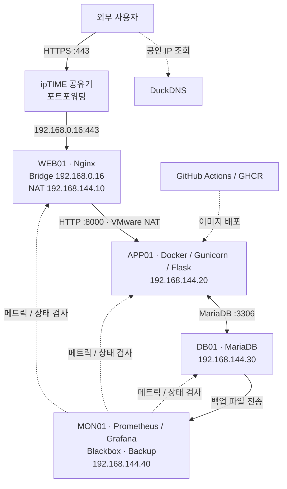

# On-Premise Infrastructure Lab

> **Rocky Linux 4대 VM 기반 웹서비스 인프라 구축 및 운영**  
> VMware · Nginx · Docker · Flask · MariaDB · Prometheus · Grafana · GitHub Actions

## 프로젝트 소개

소규모 웹서비스 운영 환경을 가정해 **WEB, APP, DB, Monitoring 서버 4대를 역할별로 분리**한 온프레미스 인프라 프로젝트입니다. VMware에 Rocky Linux를 설치하고, 외부 사용자의 HTTPS 요청이 Nginx → Flask → MariaDB로 이어지는 서비스를 구축했습니다.

서비스를 띄우는 데서 끝내지 않고 **네트워크 및 접근 제어, 모니터링과 장애 알림, DB 백업·복원, 이미지 배포와 롤백**까지 실제로 검증하는 데 중점을 두었습니다.

- **기간:** 2026.10 ~ 2026.11
- **환경:** 단일 물리 장비 / VMware / Rocky Linux 10.2 / VM 4대
- **구현 서비스:** 방명록 웹 애플리케이션
- **외부 접속 도메인:** `https://jm-onprem.duckdns.org` *(실습 환경으로 상시 운영을 보장하지 않음)*

## 아키텍처

| 서버 | 네트워크 | 역할 |
|---|---|---|
| **WEB01** | Bridge `192.168.0.16` / NAT `192.168.144.10` | 외부 HTTPS, Nginx Reverse Proxy |
| **APP01** | NAT `192.168.144.20` | Docker 기반 Flask 웹 애플리케이션 |
| **DB01** | NAT `192.168.144.30` | MariaDB 데이터 저장 및 백업 |
| **MON01** | NAT `192.168.144.40` | 메트릭 수집, HTTP 검사, 장애 알림, 백업 보관 |

## 기술 스택과 선정 이유

| 구분 | 기술 | 사용한 이유 |
|---|---|---|
| 서버 / 가상화 | **Rocky Linux, VMware** | RHEL 계열 서버 운영을 실습하고 서비스를 역할별 VM으로 분리 |
| 네트워크 | **Bridge, VMware NAT, ipTIME** | 외부 웹 접속 경로와 VM 간 내부 통신 경로를 구분 |
| 웹 / 보안 | **Nginx, Certbot, DuckDNS** | Reverse Proxy, HTTPS, 공인 IP 변경 대응 |
| 애플리케이션 | **Docker, Gunicorn, Flask** | 실행 환경을 이미지로 관리하고 앱과 DB의 연동 구현 |
| 데이터베이스 | **MariaDB** | 방명록 영구 저장 및 백업·복원 실습 |
| 접근 제어 | **firewalld, iptables DOCKER-USER, Tailscale** | 필요한 서버/포트만 허용하고 VPN으로 원격 관리 |
| 모니터링 | **Prometheus, Node Exporter, Blackbox Exporter, Grafana, Telegram** | 서버 자원과 실제 HTTP 응답을 구분해 감시하고 장애 알림 수신 |
| 운영 자동화 | **systemd Timer, GitHub Actions, GHCR** | 백업·도메인 갱신 예약, 이미지 빌드·배포 및 롤백 |

## 주요 구성 및 운영

### 네트워크와 외부 HTTPS 접속

WEB01을 **Bridge와 VMware NAT 두 네트워크에 연결**했습니다. Bridge 인터페이스는 공유기 LAN에서 웹 요청을 수신하고, NAT 인터페이스는 APP01 등 내부 VM과의 통신에 사용합니다.

가정용 공유기 뒤의 WEB01은 사설 IP를 사용하므로, 외부에서 도메인만 입력한다고 바로 접속할 수 없습니다. 이를 해결하기 위해 **ipTIME 공유기의 포트포워딩**으로 외부 요청을 WEB01에 전달했습니다.

| 공유기 외부 포트 | 전달 대상 | 목적 |
|---|---|---|
| **TCP 443** | `192.168.0.16:443` | 외부 HTTPS 서비스 |
| **TCP 80** | `192.168.0.16:80` | Let's Encrypt HTTP-01 인증 및 갱신 |

**접속 흐름:** `DuckDNS로 공유기 공인 IP 조회 → ipTIME :443 → WEB01 Nginx → APP01 :8000 → DB01 :3306(필요 시)`

- **DuckDNS:** 공인 IP 변경 시 도메인 정보를 갱신하도록 예약 작업 구성
- **Certbot:** HTTPS 인증서 발급 및 자동 갱신 설정
- **Tailscale:** 서버 관리용 VPN 연결 구성

외부 휴대폰 5G 환경에서 HTTPS 접속, 방명록 작성, DB 저장까지 확인했습니다.

### 웹서비스와 데이터베이스

- **WEB01 / Nginx:** 외부에서 TLS 연결을 받고 내부 APP01으로 HTTP Reverse Proxy. 요청 속도 제한 적용.
- **APP01 / Docker·Flask:** `192.168.144.20:8000`에 서비스를 바인딩하고 `DOCKER-USER` 규칙으로 WEB01에서 오는 접근만 허용. `/health`는 앱 응답, `/ready`는 DB 연결을 포함한 준비 상태 확인.
- **DB01 / MariaDB:** 방명록 데이터 저장. APP01에서 DB 포트에 접근하도록 제한하고 systemd 자동 시작·비정상 종료 시 재시작 설정 적용.

### 모니터링과 장애 알림

MON01에 Prometheus, Grafana, Node Exporter, Blackbox Exporter를 구성했습니다. **서버가 실행 중인 것과 웹서비스가 실제로 응답하는 것은 다르므로** 시스템 메트릭과 HTTP 상태 검사를 함께 사용했습니다.

- **Node Exporter:** CPU, 메모리, 디스크 등 4대 서버의 시스템 상태
- **Blackbox Exporter:** 내부 HTTP 및 외부 HTTPS 응답 검사
- **Grafana / Telegram:** 서버 다운·웹 HTTP 검사 실패 알림 및 수신 검증

Prometheus의 `up`은 메트릭 수집 성공 여부, Blackbox의 `probe_success`는 실제 검사 성공 여부로 구분했습니다.

### DB 백업·복원 및 CI/CD

| 항목 | 구성 및 검증 |
|---|---|
| **정기 백업** | DB01에서 매일 03:00 백업, 로컬 7일 보관 |
| **별도 VM 보관** | 백업 파일을 MON01에 10분 주기로 전송 확인, 30일 보관 |
| **복원** | 기존 백업 파일로 데이터 복원 및 비교 테스트 |
| **배포** | GitHub Actions → GHCR 이미지 관리 → APP01 배포 |
| **롤백** | 커밋 SHA 기반 이미지 버전 관리 및 이전 버전 롤백 검증 |

반복 작업을 줄이고 장애 시 복구 가능한 상태를 만들기 위해 **systemd Timer와 CI/CD**를 적용했습니다. 다만 DB01과 MON01은 같은 물리 장비에서 구동되므로 물리 디스크 전체 장애에 대비하려면 별도 저장소가 필요합니다.

## 장애 대응 및 검증

### Prometheus 비정상 종료

Grafana에 `No Data`가 표시되어 MON01의 Docker 상태를 확인했고, Prometheus 컨테이너가 **종료 코드 255**로 중단된 것을 발견했습니다. 로그와 종료 상태를 확인한 뒤 컨테이너를 재실행해 메트릭 수집을 복구했습니다. **종료 원인은 확정하지 못했으며**, 향후 추가 분석 항목으로 남겼습니다.

### 서비스 복구 및 배포 검증

- 서버 4대 재부팅 후 Nginx, MariaDB, 애플리케이션 및 모니터링 컨테이너 자동 실행 확인
- WEB01에서 APP01의 `/health`, `/ready`에 대한 **HTTP 200** 응답 확인
- 외부 5G망에서 HTTPS 접속 후 방명록 작성 및 MariaDB 저장 확인
- 백업 파일 생성·MON01 전송, 기존 백업 파일 복원 테스트
- Grafana의 Telegram 알림 수신 확인
- GitHub Actions 기반 배포와 이전 이미지 롤백 검증

## 개선 방향

- **물리적으로 분리된 백업:** 단일 호스트 장애에 대비해 다른 장비 또는 외부 저장소에 추가 보관
- **구성 재현성:** 수동으로 구축한 VM 및 서비스 설정을 재현 가능한 방식으로 문서화·자동화
- **장애 분석:** Prometheus 비정상 종료의 근본 원인 추적 및 정기 복원 테스트 확대

> **참고:** 이 저장소에는 실제 확인한 결과를 중심으로 기록하며, 비밀번호·API 토큰·인증서 개인키·DB 백업 데이터는 공개하지 않습니다.
