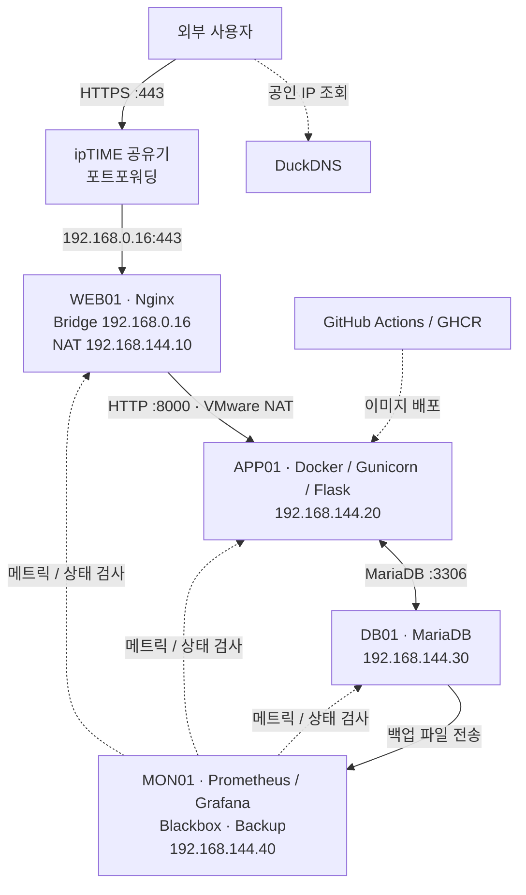

[README.md](https://github.com/user-attachments/files/34610270/README.md)
# On-Premise Infrastructure Lab

> **Rocky Linux 서버 4대를 활용한 온프레미스 웹 서비스 구축 및 운영**  
> VMware · Nginx · Docker · MariaDB · Prometheus · Grafana · GitHub Actions

## 프로젝트 개요

홈 네트워크의 공인 IP와 공유기 포트포워딩을 활용해 외부에서도 HTTPS로 접속할 수 있는 온프레미스 웹 서비스 환경을 구축한 프로젝트입니다.

VMware 환경에 Rocky Linux 서버 4대를 구성하고, 웹 서버, 애플리케이션 서버, MariaDB 데이터베이스 서버, Prometheus와 Grafana를 활용한 모니터링 서버로 역할을 분리했습니다.

단순히 방명록 웹 서비스를 구현하는 데서 끝내지 않고, 외부 접근을 제한하면서 서비스를 운영하고, 장애 감지와 데이터 백업·복원, 배포 버전 롤백까지 직접 검증하는 데 중점을 두었습니다.

- **진행 기간:** 2026.10 ~ 2026.11
- **실습 환경:** 단일 물리 장비 / VMware / Rocky Linux 10.2 / VM 4대
- **구현 서비스:** 방명록 웹 애플리케이션
- **접속 도메인:** `https://jm-onprem.duckdns.org` (실습 환경으로 상시 운영하지 않을 수 있음)

## 프로젝트 목표

- VMware 환경에서 Rocky Linux 서버 4대를 역할별로 분리하고, Nginx와 Docker, MariaDB를 연동하여 외부에서도 HTTPS로 접속할 수 있는 웹 서비스를 구축한다.
- Bridge와 NAT 네트워크를 구분하고, 방화벽과 Nginx Reverse Proxy를 이용해 외부 접근 경로와 서버 간 통신을 제한한다.
- Prometheus와 Grafana로 서버 자원과 웹 서비스 상태를 모니터링하고, 장애가 발생하면 Telegram으로 알림을 받도록 설정한다.
- MariaDB 데이터를 정기적으로 백업하고 다른 VM에도 보관하여, 실제 데이터 복원을 통해 백업 파일의 정상 여부를 확인한다.
- GitHub Actions를 이용해 애플리케이션 배포를 자동화하고, 문제가 발생했을 때 이전 Docker 이미지로 되돌릴 수 있도록 한다.
- 서비스 운영 중 발생한 장애의 상태와 로그를 확인하고 복구 과정을 기록하여, 문제 발생 시 대응하는 방법을 익힌다.

## 기술 스택

- **OS:** Rocky Linux 10.2
- **가상화:** VMware
- **네트워크:** Bridge, VMware NAT, ipTIME 포트포워딩, Tailscale
- **Web / HTTPS:** Nginx (Reverse Proxy), Certbot, DuckDNS
- **Application:** Python, Flask, Gunicorn (AI의 도움을 받아 만든 간단한 방명록 애플리케이션)
- **컨테이너:** Docker, Docker Compose
- **DB:** MariaDB
- **보안 / 접근 제어:** firewalld, iptables (`DOCKER-USER`)
- **모니터링 / 알림:** Prometheus, Grafana, Node Exporter, Blackbox Exporter, Telegram
- **백업 / 자동화:** Shell Script, systemd Timer
- **CI/CD:** GitHub Actions, GitHub Container Registry (GHCR)

## 아키텍처



| 서버 | 네트워크 | 역할 |
|---|---|---|
| **WEB01** | Bridge `192.168.0.16` / NAT `192.168.144.10` | 외부 HTTPS 요청 수신, Nginx Reverse Proxy |
| **APP01** | NAT `192.168.144.20` | Docker 기반 Flask 웹 애플리케이션 실행 |
| **DB01** | NAT `192.168.144.30` | MariaDB 데이터 저장, 백업 및 복원 |
| **MON01** | NAT `192.168.144.40` | 모니터링, 장애 알림, 백업 파일 보관 |

## 네트워크 구성

VMware에서 `192.168.144.0/24` 대역의 NAT 네트워크를 구성하고, WEB01, APP01, DB01, MON01 서버 4대가 내부 네트워크에서 통신하도록 설정했습니다.

WEB01에는 Bridge와 NAT 네트워크를 함께 연결했습니다. Bridge는 공유기를 통해 외부 요청을 받는 용도로 사용하고, NAT는 내부 서버와 통신하는 용도로 분리했습니다.

외부 사용자가 웹 서비스에 접속할 수 있도록 ipTIME 공유기에서 포트포워딩을 설정하고, DuckDNS와 Certbot을 활용해 도메인 접속과 HTTPS 통신을 구성했습니다.

APP01과 DB01에는 공유기 포트포워딩을 설정하지 않았습니다. 외부 요청은 WEB01의 Nginx를 거치도록 하고, 내부 서버는 방화벽 규칙으로 필요한 통신만 허용했습니다.

| 공유기 외부 포트 | 전달 대상 | 용도 |
|---|---|---|
| TCP `443` | `192.168.0.16:443` | 외부 HTTPS 접속 |
| TCP `80` | `192.168.0.16:80` | Let's Encrypt 인증서 발급·갱신을 위한 HTTP-01 인증 |

## 주요 기술 선정 이유와 구현 내용

### 1. Nginx로 외부 접속 경로 분리

애플리케이션 서버를 외부에 직접 노출하는 대신 WEB01에서 요청을 받도록 구성했습니다. Nginx가 HTTPS 연결을 처리하고, 내부 NAT 네트워크를 통해 APP01의 `8000` 포트로 요청을 전달합니다.

이렇게 하면 외부에서 접근하는 지점을 WEB01로 한정하고, 애플리케이션 서버는 내부 통신에 집중하도록 역할을 나눌 수 있습니다. Nginx에는 요청 속도 제한도 적용했습니다. 외부 휴대폰 5G 환경에서 HTTPS로 접속해 방명록을 작성하고, 입력 내용이 MariaDB에 저장되는 것을 확인했습니다.

### 2. Docker로 애플리케이션 실행 환경 관리

이번 프로젝트는 애플리케이션 개발보다 서버 간 연동과 운영에 초점을 맞췄습니다. 방명록 애플리케이션은 Python과 Flask를 이용해 AI의 도움을 받아 간단하게 만들었습니다.

APP01에서는 Gunicorn으로 앱을 실행하고, Docker 이미지와 Compose로 실행 환경을 관리했습니다. 컨테이너의 서비스 포트는 APP01의 NAT 주소인 `192.168.144.20:8000`에 바인딩하고, `DOCKER-USER` 규칙으로 WEB01에서의 접근만 허용하도록 설정했습니다.

앱 자체의 응답을 확인하는 `/health`와 DB 연결 여부까지 확인하는 `/ready`를 구분해, 웹 프로세스가 실행 중인 상태와 실제 서비스 준비 상태를 나누어 점검했습니다.

### 3. Prometheus와 Grafana로 서버 상태와 서비스 상태 구분

서버가 실행 중이어도 웹페이지가 정상 응답하지 않을 수 있어서, 자원 사용률과 HTTP 응답을 따로 확인하도록 구성했습니다.

- **Node Exporter:** CPU, 메모리, 디스크 등 서버 자원 상태 수집
- **Blackbox Exporter:** 내부 HTTP 및 외부 HTTPS 응답 검사
- **Prometheus:** 메트릭 수집 및 상태 확인
- **Grafana / Telegram:** 상태 시각화와 장애 알림 확인

Prometheus의 `up`은 메트릭 수집 성공 여부를, Blackbox Exporter의 `probe_success`는 요청에 대한 검사 성공 여부를 나타내므로 용도를 구분해서 사용했습니다.

### 4. MariaDB 백업과 복원 검증

방명록 데이터가 저장되는 DB01에서 백업 파일을 만들고, 서버 장애에 대비해 MON01에도 복사하도록 구성했습니다. 백업 파일을 만드는 것만으로는 복구 가능 여부를 확신할 수 없기 때문에 실제 데이터를 복원하고 내용을 비교하는 테스트도 진행했습니다.

| 항목 | 구성 및 확인 결과 |
|---|---|
| DB01 정기 백업 | 매일 03:00 실행, 로컬 7일 보관 |
| MON01으로 백업 전송 | 10분 주기 전송 확인, 30일 보관 |
| 복원 검증 | 기존 백업 파일을 이용한 복원 및 데이터 확인 |

다만 DB01과 MON01이 같은 물리 장비에서 실행되므로, 이 구성만으로 물리 장비 전체의 장애까지 대비할 수는 없습니다.

### 5. GitHub Actions로 배포와 롤백 관리

애플리케이션을 수정할 때마다 APP01에서 수동으로 이미지를 빌드하는 대신, GitHub Actions로 Docker 이미지를 빌드해 GHCR에 등록하고 APP01에 배포하도록 구성했습니다.

이미지에는 `latest` 외에 커밋 SHA 태그를 사용해 배포 버전을 구분했습니다. 배포 과정에서는 Tailscale과 SSH를 이용해 APP01에 접근하도록 했고, 이전 이미지로 되돌리는 롤백도 검증했습니다.

## 장애 대응 시나리오

이번 프로젝트에서는 서버 프로세스가 실행 중이어도 방화벽이나 데이터베이스 연결 문제로 실제 웹서비스가 정상적으로 동작하지 않을 수 있다는 점을 확인하고자 했습니다. 장애 발생 후 상태를 확인하고 원인을 좁힌 다음, 설정을 복구하고 서비스 동작을 재검증하는 과정을 기록합니다.

> **진행 상태:** Scenario 01은 실제 장애 재현 전 작성한 실습 계획입니다. 아래 예상 결과는 실습 후 실제 출력과 캡처로 교체합니다. Scenario 02는 실제 겪었던 장애를 바탕으로 작성했습니다.

### Scenario 01. DB01 방화벽 차단으로 인한 DB 연결 장애 (재현 예정)

**상황**

WEB01에서 Nginx를 통해 APP01에 요청을 전달하고, APP01이 DB01의 MariaDB(`192.168.144.30:3306`)에 연결하는 구조입니다. APP01에서 DB01로 향하는 DB 접근을 일시적으로 차단해, 애플리케이션 자체는 실행 중이지만 방명록의 데이터 조회·저장이 실패하는 상황을 재현할 계획입니다.

**탐지**

WEB01에서 APP01의 `/health`와 `/ready`를 각각 확인합니다. `/health`는 앱 프로세스 응답만 확인하지만, `/ready`는 DB 연결 여부까지 확인하므로 DB 연결이 차단되면 두 결과가 다르게 나타날 것으로 예상됩니다.

| 점검 대상 | 정상 상태 예상 | DB 접근 차단 시 예상 |
|---|---|---|
| APP01 `/health` | HTTP 200 | HTTP 200 |
| APP01 `/ready` | HTTP 200 | HTTP 503 |
| 방명록 조회·저장 | 정상 | 실패 가능 |

```bash
# WEB01에서 실행
curl -s -o /dev/null -w 'health: %{http_code}\n' http://192.168.144.20:8000/health
curl -s -o /dev/null -w 'ready: %{http_code}\n' http://192.168.144.20:8000/ready
```

**원인 분석**

DB01의 MariaDB 프로세스와 TCP `3306` 리스닝 상태를 확인하고, APP01에서 DB01로 연결되는 경로 및 방화벽 규칙을 점검합니다. DB 서비스가 실행 중인데 APP01에서만 접근하지 못한다면 DB 자체의 중지와 네트워크 접근 차단을 구분할 수 있습니다.

```bash
# DB01에서 읽기 전용 상태 확인
sudo systemctl is-active mariadb
sudo ss -lntp | grep ':3306'
sudo firewall-cmd --get-active-zones
sudo firewall-cmd --get-zone-of-interface=ens160
sudo firewall-cmd --list-all
```

**복구**

실습에서 추가한 **임시 차단 규칙만 제거**하고 APP01에서 DB01로 다시 접속되는지 확인합니다. 기존 방화벽을 비활성화하거나 모든 포트를 허용하는 방식으로 해결하지 않습니다. 방화벽 Zone과 현재 허용 규칙을 먼저 확인한 뒤, 자동 만료되는 일시적 규칙으로 재현할 계획입니다.

**검증**

복구 후 `/health`와 `/ready`가 모두 HTTP 200을 반환하는지 확인하고, 외부 HTTPS 접속에서 테스트 방명록을 작성해 DB에 저장되는지 확인합니다. 실행 과정의 실제 출력과 스크린샷을 추가한 뒤 결과를 기록합니다.

**증빙 이미지 계획 (실습 후 추가)**

- `screenshots/scenario-01-detection.png`: `/health` 정상 응답과 `/ready` 실패 비교
- `screenshots/scenario-01-analysis.png`: DB 서비스 실행 상태, 리스닝 포트, 방화벽 규칙
- `screenshots/scenario-01-recovery.png`: 차단 해제 후 `/ready` 복구 및 DB 저장 확인

**확인하려는 점**

서비스 프로세스가 살아 있는 것과 서비스가 정상적으로 요청을 처리할 준비가 된 것은 다를 수 있습니다. 또한 통신 장애를 해결할 때 방화벽을 모두 해제하지 않고 필요한 경로만 허용하는 접근 제어 방식이 중요하다는 점을 검증하고자 합니다.

### Scenario 02. Prometheus 컨테이너 비정상 종료 (실제 발생)

**상황**

Grafana 대시보드에서 모니터링 데이터가 표시되지 않고 `No Data` 상태가 발생했습니다.

**탐지**

MON01에서 Docker 컨테이너 상태를 확인한 결과, Prometheus 컨테이너가 종료 코드 `255`로 중단된 것을 확인했습니다.

**원인 분석**

컨테이너 상태와 로그를 점검했으나 비정상 종료의 **근본 원인까지는 특정하지 못했습니다.**

**복구**

컨테이너 상태와 로그를 점검한 뒤 Prometheus 컨테이너를 다시 실행했습니다.

**검증**

메트릭 수집이 재개되었고 Grafana에서 서버 모니터링 데이터가 다시 표시되는 것을 확인했습니다. 당시 증빙 화면이 확보되면 추가할 예정입니다.

**배운 점**

모니터링 대상뿐 아니라 Prometheus 같은 모니터링 시스템 자체도 장애가 발생할 수 있다는 점을 확인했습니다. 비슷한 문제가 반복되면 종료 시점의 컨테이너 로그와 호스트 자원 상태를 함께 수집해 원인을 분석할 계획입니다.

## 운영 검증 결과

### 실제로 확인한 운영 항목

- 서버 4대 재부팅 후 Nginx, MariaDB, 애플리케이션 및 모니터링 컨테이너의 자동 실행 확인
- WEB01에서 APP01의 `/health`, `/ready`에 대해 HTTP `200` 응답 확인
- 외부 5G 환경에서 HTTPS 접속, 방명록 작성 및 DB 저장 확인
- DB 백업 파일 생성·MON01 전송 및 실제 복원 확인
- Grafana를 통한 Telegram 장애 알림 수신 확인
- GitHub Actions 배포 및 이전 이미지로 롤백 확인

## 주요 증빙 자료 (캡처 추가 예정)

README의 설명과 실제 동작 결과를 연결할 수 있도록 핵심 화면만 선별해 기록할 예정입니다. 캡처를 확보한 뒤 `screenshots/` 폴더에 추가하고, 아래 항목을 이미지 링크로 교체합니다.

| 항목 | 확인할 내용 |
|---|---|
| 외부 HTTPS 접속 | 모바일 데이터망에서 방명록 접속 및 저장 |
| DB 연동 | 작성한 방명록이 MariaDB에 저장된 결과 |
| 접근 제어 | Nginx 프록시 설정과 필요한 서버만 허용한 방화벽 규칙 |
| 모니터링 | Grafana에서 WEB/APP/DB/MON 서버 상태 확인 |
| 장애 알림 | Telegram 알림 수신 화면 |
| 백업·복원 | 백업 파일과 복원 후 데이터 확인 |
| CI/CD·롤백 | GitHub Actions 성공 및 이전 이미지로 전환한 기록 |
| 장애 대응 | DB 접근 차단 전·후 응답과 복구 결과 (재현 후 추가) |

## 개선할 부분

- **백업 보관 위치:** 단일 물리 장비 장애에도 대비할 수 있도록 별도 저장소나 다른 장비에 추가 백업
- **구성 재현성:** 수동 설정한 네트워크·서비스 구성을 문서화하고 재현 방법 정리
- **장애 원인 분석:** Prometheus 비정상 종료 원인 추가 확인 및 복원 테스트 반복
- **IP 관리:** WEB01의 Bridge 주소가 변경되지 않도록 공유기 DHCP 주소 예약 여부 점검

---

> **공개 자료 안내:** 비밀번호, API 토큰, SSH 개인키, 인증서 개인키 및 DB 백업 원본은 공개하지 않습니다. 실제 설정 파일과 운영 검증 화면은 민감 정보를 제거한 뒤 필요한 자료만 선별해 추가할 예정입니다.
